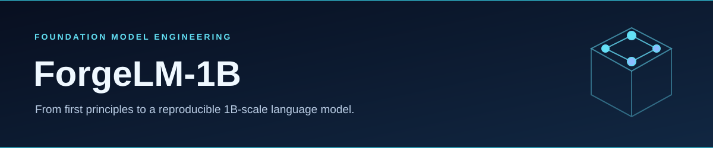

<div align="center">



### From first principles to a reproducible 1B-scale language model.

[Roadmap](docs/ROADMAP.md) · [Architecture](docs/ARCHITECTURE.md) · [Experiment registry](docs/EXPERIMENTS.md) · [Research log](docs/RESEARCH_LOG.md) · [Project website](https://anass19.github.io/ForgeLM-1B/)

</div>

---

## Overview

ForgeLM-1B is an open research engineering project to design, pretrain, evaluate, and eventually serve an approximately one-billion-parameter decoder-only language model. The model size is a target, not an accomplished training run.

**Status:** Research preparation. **No completed 1B/4B training runs, released model weights, or benchmark results are claimed.**

## Engineering areas

- Tokenizer and data preparation
- Attention and Transformer mathematics
- Numerically stable training and custom gradient checks
- Optimization, checkpointing and profiling
- Model evaluations and inference deployment

## Milestones

| Stage | Milestone | Acceptance criterion | Status |
|---|---|---|---|
| 01 | Define research requirements | Architecture candidates, token budget, context length, evaluation and compute envelope | In progress |
| 02 | Build and test model internals | Tokenizer, embeddings, normalization, attention, MLP, loss and training loop | Planned |
| 03 | Run small-scale validation | Gradient checks, convergence, reproducibility and checkpoint recovery | Planned |
| 04 | Prepare data and training systems | Licensed datasets, filtering, deduplication, sharding, profiling and monitoring | Planned |
| 05 | Train approximately 1B parameters | Run only when data quality and sufficient compute are secured | Planned |
| 06 | Evaluate and document release | Holdout metrics, inference benchmarks, failure analysis and model card | Planned |

## Repository layout

```text
ForgeLM-1B/
├── README.md                 Project overview
├── docs/
│   ├── index.html            GitHub Pages project website
│   ├── style.css             Responsive styling
│   ├── assets/               Minimal SVG brand assets
│   ├── ROADMAP.md            Milestone acceptance criteria
│   ├── ARCHITECTURE.md       Research design decisions
│   ├── EXPERIMENTS.md        Results and reproducibility registry
│   └── RESEARCH_LOG.md       Dated activity notes
├── src/                      Planned core implementations
├── data/                     Dataset documentation (no raw corpora)
├── configs/                  Future experiment configurations
├── tests/                    Future numerical/integration tests
├── evals/                    Future evaluation code
├── experiments/              Future experiment records
├── infra/                    Compute and deployment notes
├── scripts/                  Future entry points
└── .github/                  Issue and pull-request templates
```

*Directories with only README files describe intended structure, not completed software.*

## Research principles

1. Record precise assumptions, versioned configs, sources and datasets.
2. Separate proposed work, experiment runs, verified metrics and model releases.
3. Preserve validation evidence, reproducibility metadata, numerical checks and failures.
4. Report actual hardware use, training tokens, parameter counts and operating costs only after measurement.
5. Avoid publishing credentials, proprietary datasets or uncontrolled model artifacts.

## Project boundaries

The existing [ForgeAi](https://github.com/ANASS19/ForgeAi) repository is an **independent, unchanged practice workspace for sub-1B and first-principles exercises**. This project is a separate milestone. See the [ForgeAI roadmap](https://github.com/ANASS19/ForgeAI-Roadmap) for the broader program.

## Collaboration and license

Technical discussion and issues are welcome. A source/model license has not yet been selected; public source visibility alone does not grant reuse rights. Appropriate licenses will be chosen before sharing reusable implementations or weights.

---

Maintained by [ANASS19](https://github.com/ANASS19) · Forge AI research engineering.
